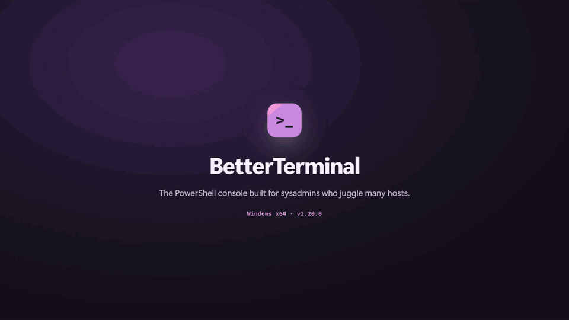

# BetterTerminal

BetterTerminal is a Windows desktop PowerShell console for sysadmins who work on several hosts at once. Run
commands locally or over WinRM or SSH, and see the output as searchable tables, service and system cards and
charts alongside live host metrics.

**[▶ Watch the demo in 1080p](media/betterterminal-demo.mp4)** (1:42, MP4). The preview above plays at double speed.

This repository publishes BetterTerminal's releases and the feed installed copies use to update themselves.
It contains no source code.

## Install

Download `BetterTerminal-<version>-x64-setup.exe` from the
[latest release](https://github.com/abobneil/BetterTerminal-releases/releases/latest) and run it. It needs
Windows 10 version 1809 or later, or Windows 11, on x64, and installs Microsoft Edge WebView2 Runtime if it
is missing. A portable zip is attached to each release as well; it needs WebView2 Runtime already installed.

Installed copies update themselves: use the update button in the title bar, or **Check for updates** in the
command palette (Ctrl+Shift+P). The installer and app are unsigned. `SHA256SUMS.txt` in each release lists
the SHA-256 of every download.

## Release notes

### 1.22.0 - 2026-11-25

#### Added

- Connect to your devices over the internet with Tailscale, built into BetterTerminal. Sign in from Settings → Tailscale: Tailscale's page opens in your browser, so Google, Microsoft, GitHub and your company's sign-in work, or paste an auth key your tailnet hands out. Nothing else needs installing, and only BetterTerminal's own connections use the tailnet; the rest of the PC isn't affected.
- The connect dialog lists your tailnet's devices, online first, with their tailnet address, when offline ones were last seen, and which run Tailscale SSH. Pick one and BetterTerminal chooses SSH for Linux and macOS or WinRM for Windows. Names in your tailnet and 100.x addresses go through it on their own; for anything else, such as a NAS behind your homelab's subnet router, tick Through the tailnet.
- Devices running Tailscale SSH sign you in with your tailnet identity, with no password or key to set up. SSH and WinRM hosts work as before, with host keys and saved sign-ins kept under the device's own name.
- Profiles, to keep Personal and Business apart. Each profile has its own Tailscale account, saved hosts, sign-ins, saved passwords, shared credentials, command history and incidents; settings, the library and runbooks are shared. Switch from the title bar or Settings → Profiles. Tabs keep running when you switch, show their profile's color, and both profiles' tailnets can be connected at the same time. Everything you had before becomes the Personal profile.
- Tailscale options per profile: use subnet routes (on by default), a custom control server for Headscale, and whether to send Tailscale's client logs to Tailscale (off by default; some business tailnets require it). BetterTerminal warns before this PC's Tailscale key expires and when a tailnet needs you to sign in again.
- When Tailscale's servers can't be reached, for example behind a firewall or web filter that blocks them, Settings says so instead of waiting.
- Settings → Module packs now has a Windows RSAT section listing Active Directory, Group Policy, DNS Server and DHCP Server tools, whether each is installed on this PC, and an Install with Windows button. Before, RSAT was only offered after one of its commands failed. Windows asks for an administrator's permission first.
- Network map: a map of everything this PC can see about a network, built up through the layers from link speeds, VLANs and switch ports to subnets, open ports, certificates and published services. Open it with Ctrl+Shift+M. Scans run at three levels you choose: Look reads only this PC; Ask around finds devices on the subnets you tick; Probe also checks ports, greetings and TLS certificates, after you confirm the targets each time. Large, public, VPN and Public-network scopes need an explicit confirmation.
- Cards you run in any tab add to the map automatically: neighbours, MAC and ARP tables, VLANs, spanning tree, ports and routes from network devices, virtual switches and VMs from hypervisors, and this PC's network commands. You can turn this off per map.
- A network scan can sign in on its own to devices that already have a saved SSH sign-in, read them with read-only commands and sign out, without ever asking for anything. Devices it couldn't read are listed with the reason. It can also read devices over SNMP v2c or v3 with credentials you save in the vault.
- Each scan leaves a card on the timeline with its layers, counts, what changed and everything it read or signed in to, and shows in Activity with Stop.
- In the map: topology by cabling or subnets, an outline, device and service tables, flows with an A-to-B path trace, changes between scans, and every fact's source and certainty. Rename devices, add notes and tags, and merge duplicates. Export as SVG, PNG, draw.io, Mermaid, JSON or CSV, with addresses and names redacted by default.

### 1.21.0 - 2026-11-24

#### Added

- Install, hide and show updates, and restart this PC, without running BetterTerminal as administrator. On this PC's tab, those buttons now queue the change in a new Admin changes list in the updates alert. Review and run shows the exact command, and Windows asks for an administrator once for the whole list. Nothing of BetterTerminal's runs as administrator: the command is Windows' own PowerShell, shown in full under Show more details in Windows' prompt, so you can check it there before you say yes. This works when that prompt asks for a separate administrator account.
- Each queued update is changed only at the version you queued. If Windows Update replaces it before the run, it is left alone and the list says so. Afterwards, the result of each change is read back from Windows Update itself.
- Restart as administrator, for work on this PC that needs the whole app elevated: press Ctrl+K and search for it. BetterTerminal asks first if closing would stop running work, and declining the Windows prompt leaves everything as it was. On a standard Windows account it says first that the new window runs as the administrator account, with that account's own settings, history, saved hosts and vault.
- Hide optional updates you don't want. Each optional update has a Hide button, which hides it in Windows Update itself (as Microsoft's "Show or hide updates" tool does), so Windows and BetterTerminal stop offering it. Hidden updates are listed in a collapsed Hidden group with a Show button to offer them again. Hiding needs an administrator: on this PC it joins the Admin changes list; on a remote host BetterTerminal makes the change through a one-off SYSTEM task, as installs do.

#### Fixed

- On a Windows host connected over WinRM, the pending updates list now updates after you install or hide updates. It used to keep showing the list from the first check.
- Starting BetterTerminal normally while a copy runs as administrator under the same Windows account now says so, instead of failing to start.

### 1.20.0 - 2026-11-21

#### Added

- VMware PowerCLI is a module pack. Type `Connect-VIServer` (or any PowerCLI command) and BetterTerminal offers to install it, or install it in Settings › Module packs. It loads in the tab after Windows' own modules, so on a Hyper-V PC `Get-VM` and `Get-VMHost` stay Hyper-V's until you connect to vCenter or ESXi. Installing it downloads about 410 MB from PSGallery.
- When `Connect-VIServer` fails on a self-signed certificate, the card offers the command again with PowerCLI asking whether to trust the certificate, for this session only.
- `Get-VMHostNetworkAdapter` (PowerCLI) shows the host's physical NICs with link speed and duplex, and its VMkernel adapters with port group, address, MTU and the traffic each carries (Management, vMotion, vSAN and more).
- Choose how often a host's metrics are read: click the rate on the metric strip and pick Auto, every 1 s, every 5 s or Off. The choice is saved for that host. Hovering the rate, or the graphs, says how often readings come and why, for example "Every 250 ms · auto", "slowed: host busy" or "hidden tab".
- Command suggestions open as soon as you type one letter of a command, in PowerShell and bash tabs. Each command has a short description, and the list is grouped into the commands you ran recently in this tab, BetterTerminal's own commands, PowerShell commands, module pack commands, aliases and programs. Press → at the end of the line or F1 to see the command's syntax and where it comes from; the app remembers whether you left this open.
- Your recent and most-used commands are listed first, so a single letter finds commands such as Get-Service instead of rarely used ones.

#### Changed

- Settings › Microsoft 365 is now Settings › Module packs, with Microsoft 365, VMware and Windows groups.
- The metric strip scrolls smoothly and reacts faster. The local PC and Linux hosts over SSH are read every 250 ms, and Windows hosts over WinRM every 1 s. On Auto the rate slows down when the host is busy, or when reading costs the host more than half a percent of one CPU core (one percent over PowerShell remoting, where each reading has a fixed remoting cost). Each new reading glides in and the line still ends at the last real reading: nothing is guessed between readings. With reduced motion turned on in Windows, the strip updates in steps as before.
- Reading metrics costs your hosts less. A Linux host runs one light loop with no new process per reading, and a Windows host runs one long-running remote command instead of a new remote command with five WMI queries every second. On the test hosts that cut the collector's CPU use by about three quarters, even when reading four times as often.
- The rate adapts so it never overloads a host. It slows down when readings come in late, when the host's CPU is already high, when reading would cost the host more than a sliver of a core, or when the host throttles requests. Tabs you are not looking at are read every 2 s, and every tab every 5 s while the window is minimized. Alerts still arrive as before.
- After a failed sign-in the strip stops reading that host instead of retrying, so it cannot lock the account or trip SSH login limits. Pick a rate to try again.
- On XCP-ng the strip is labelled dom0 and, where xentop is available, shows the whole host's CPU. On a Nutanix controller VM it is labelled CVM, because the readings are the CVM's, not the host's.
- When the suggestion list opens by itself, Enter runs exactly what you typed unless you move the highlight with the arrow keys. Tab takes the highlighted command, and Esc hides the list until your next command. Network devices still complete on Tab only.

#### Fixed

- The metric strip no longer shows readings it did not take. When samples are missing (a dropped connection, a reconnect, a failed reading) the line breaks instead of being drawn straight across the gap, and the crosshair shows "—" inside a gap. A value the host did not report, such as the first CPU or network reading before there is anything to compare it with, or a counter that failed, shows as "not reported" instead of 0%, and a lane with no readings in range says so instead of drawing a flat line.
- Commands whose end was never seen (the connection dropped or the app closed while they ran) say "exit code unknown" on their card, in Activity, the tray and notifications, rather than implying success. A command that could not be started or confirmed no longer reports a made-up exit code 1 and 0 ms.
- Cards say "not reported" for values the output did not include instead of showing 0, 0 B or "No errors": Linux free, vmstat, df, ss -s, iotop and sorted ps, Get-Partition sizes, Get-NetAdapterStatistics error counters, Get-Process and tasklist memory, and network device session tables.
- Stopping a process from a process card or from "Using CPU now"/"Using memory" can no longer end a different program that later got the same process ID. The inserted command first checks that the process still has the start time the list showed; if the process has exited or its ID now belongs to another process, it stops nothing and says so. Where the start time isn't known (for example `ps aux` output), the menu says the stop is not verified.
- On Linux hosts over SSH, the Top consumers row actions insert `kill` and `ps` instead of PowerShell's `Stop-Process` and `Get-Process`.
- When you stop a running command, a process whose ID was reused in the moment the app looks for the command's child processes is no longer counted as one of them.
- Hyper-V cards fill in their extra details (VM vCPU and memory, VM counts on the host card, disk sizes and checkpoint chains, switches and adapters) on PCs that also have VMware PowerCLI installed. PowerCLI's Get-VM and Get-VMHost used to take over and fail with "You are not currently connected to any servers", leaving those fields empty. The Start, Stop, Checkpoint and other commands the cards insert now name the Hyper-V module too, so they run Hyper-V's cmdlets, and a typed `Hyper-V\Get-VM` gets the Hyper-V card.
- PowerCLI's `Get-VMHost` no longer hangs, and Stop works on it again. A property BetterTerminal read for the card made PowerCLI print a warning, and the two waited on each other.
- vSphere cards no longer show deprecation warnings your command never caused, such as "The 'State' property of VMHost type is deprecated" on `Get-VMHost` or "'Version' … is deprecated" on `Get-VM`.
- vSphere cards fill in their extra details reliably. When a card asked for several details at once, all but the first failed with "You are not currently connected to any servers"; they also work while another command runs.
- vSphere cards name PowerCLI's module in their background lookups too, so a Hyper-V module loaded later in the same tab can't take them over.
- vSphere lists keep every row complete: `Get-VM`, `Get-HardDisk`, `Get-NetworkAdapter`, `Get-Snapshot`, `Get-VirtualPortGroup` and `Get-Task` no longer drop values after the first row ("2 of 3 rows have missing values", disks and NICs without their VM).
- The `Connect-VIServer` card hides `SessionId`, which is the vSphere session cookie. A numeric session ID, as in `Get-Process`, is still shown.
- A standalone ESXi host is no longer called a "cluster host".
- A VM's power state, VMware Tools status and snapshot memory state read correctly on vSphere detail cards. `Get-View` showed "state not printed" and a stray "3".
- The VM list no longer shows a "Tags" column reading "vm" for every VM: a VM's folder is shown only when it isn't the default one. Beside "snapshots > 6 months", the second tile now reads "7 days – 6 months".
- A powered-off VM's network adapters are no longer flagged as disconnected.
- Snapshot groups show VM names as they are, not in capitals. Memory on a stopped vSphere VM reads "configured", not "startup".
- Task durations from 1 ms to a second show in milliseconds instead of "0 s".
- The event strip's time axis uses local dates, and adds the time of day when the events span under four days. vSphere events no longer show "ID 0".

### 1.19.0 - 2026-11-19

#### Added

- Light theme. Choose System, Dark or Light in Settings › Appearance or from the command palette. System follows Windows as it changes, the choice is remembered, and the window opens in the right colours with no flash.
- A search field in the title bar opens the command palette (Ctrl+K).
- Reconnect a dropped remote session without losing its timeline. The attempt can be cancelled, sign-in prompts appear again when they are needed, and a failure says why and offers a retry.
- Persistent sessions pick up where they stopped. After you close the app during a remote runbook step, reopening it recovers the step's output and result, and the run continues without running anything twice. A Resume button in the tab row shows sessions that are waiting.
- Sign in to the same host as a second account: type `account@host`, or change the user in the WinRM password prompt. Each account keeps its own sign-in settings, recent-host row and labelled tabs.
- Remove a command from history in Ctrl+R (Shift+Del or the footer button, with a confirmation). It is deleted from disk, on every host.
- Alt+End jumps to the latest command and follows it again, like the "N new" pill.
- A new tab suggests commands that work on its host, plus connecting, pasting output, searching and the shortcut sheet.
- After a restart, interrupted file transfers are listed with their source, their destination and the partial file that may be left behind, with how to clean up and retry. The notice names hosts plainly, keeps work that never started apart from files to remove, and stops returning once you have dealt with them.
- Screen readers hear status changes without losing their place: commands finishing or failing (with the exit code and first error), a prompt's question, a queued command starting, connections dropping, reconnecting and coming back, transfers, incident recording, and new commands below the visible timeline.
- Session and file tabs work fully from the keyboard: arrow keys move between tabs, Delete closes, and Shift+F10 opens the menu. Shift+F10 also opens the item menu in Library and Files lists and on recent hosts in New session.
- "Manage sessions" is in the command palette. History (Ctrl+R) says when it is showing only this host's commands and how to search all hosts, and an empty timeline after a restart points to it.
- The shortcut sheet (F1) includes the keys for the panel you are in, and the user guide covers local tabs, queues, side shells, history removal and native terminal input.

#### Changed

- The health row is one line by default. A metric that is changing or in a warning state shows a live line; Alt+M, a click or the palette opens the full graphs, in any window size. If you chose the full graphs before, they stay.
- New session checks the host name and port before it asks for a password, and every connection failure says what went wrong and what to do in one sentence, with the original error under Details.
- After a first connect the tab is ready right away: no sign-in dialog follows. BetterTerminal asks for the password each time until you choose otherwise, and a note in the tab offers to remember it or set up a key.
- The user guide and troubleshooting pages describe connecting, sign-in settings, persistent sessions and Resume as they work now.
- Every open session is visible or one click away at any window size and at zoom up to 200%. A "+N" control lists the tabs that don't fit, the active tab always stays in view, and the title bar takes two rows before tabs would disappear.
- Panels get more room in short windows: while a panel is open the health row folds away, and the prompt too below 600 px of height.
- An empty Library explains what scripts, runbooks and snippets are for and offers New and Add a source; a search with no results offers to clear it. A script's target and parameters sit right under its Run controls.
- The timeline's Run all card answers a paused run itself (retry, skip, continue, abort, done), by button or key, without opening the runbook. Files in a one-pane layout says how to reach the other pane (Tab and Shift+Tab), in the panel and in the shortcut list.
- Result cards have a one-line header: status, duration, Visual/Text, Copy and Insert, with the other actions in a More menu.
- Long results stay responsive. The palette, typing and tab switches keep working while a 5,000-item listing or an event-log query with thousands of events streams, and the tab stays light once it has loaded.
- Large plain-text output arrives up to 15 times faster. `1..200000` in a local tab now takes about 2–3 s instead of about 40 s, and `seq 1 200000` over SSH about 3 s instead of about 22 s. Long lines, coloured output and fast error output stream much faster too, and memory use while they arrive is far lower.
- Tabs with hundreds of commands scroll and switch smoothly and use much less memory. Cards far off screen give back their output and draw it again before you reach them, and what you did in a card is kept.
- Long text output says how many lines exist and how many are shown, opens on its real first lines, and loads every line from history on request. If history has no copy, it says so.
- Large file listings on a WinRM tab finish in seconds instead of over a minute: `Get-ChildItem C:\Windows\System32` took about 80 seconds on a quiet PC and now takes about 7. A card that is still receiving shows how many rows or lines have arrived.
- The first command on a new remote tab is fast: about a quarter of a second on WinRM and well under a tenth on SSH on a quiet PC, where it could take one to two seconds.
- A result taller than the window is shown from its start, with its command line at the top.
- The app loads less code at start-up; network-device, hypervisor, Linux and terminal cards and the Library, Files, viewer and runbook panels load in the background.
- Text is easier to read: nothing in the app is smaller than 11px, and labels and running text start at 12px. Buttons, fields, toggles and list rows share one look, meters and bars have visible tracks, and toolbar buttons show their names on wide windows.
- Tables and lists of rows are one Tab stop each, on the row. Up and Down move between rows (Home, End, Page Up and Page Down too), Left and Right reach a row's buttons, and Enter does its main action. This works with a screen reader running.
- Focus rings are clearer, disabled controls look disabled, small controls have 24px targets, and text, charts and status badges meet contrast in both themes.
- Every dialog holds the keyboard: the app behind it is inactive and hidden from screen readers, Esc closes it from anywhere, and focus returns to where you were.
- Closing the app or a tab asks first while commands, queued work, transfers, runbooks or an incident recording are active, or while the Library has unsaved edits. The same applies when Windows signs out or shuts down (the sign-out is held and the app asks) and before an update closes the app. Closing the app also lists temporary remote sessions that will end, as closing their tab does.
- Stop reports Stopped only after the command and every process it started have ended.
- Runbook runs keep the version they started with across edits, restarts, renames and deletion. The notebook shows what changed and can start over from the current file.
- Files: folder copies to and from Linux hosts are about four times faster, large WinRM folders list about eight times faster, and a slow folder shows that it is loading.
- Update checks explain themselves. A newer local build, an older release on the feed, out-of-date update information, a wrong PC date or time, an unreachable update server and a missing module catalog each get a plain message. A copy on the latest version stays "up to date" however long it has been since a release.
- Failure notices name what failed, and a card whose visual cannot be drawn offers a retry and its raw output.
- Incident reports word versions, durations and command results more clearly. Host summaries, the notebook and the export agree on step counts, and the export names the runbook version that ran.
- Streaming command output updates in batches, finished cards avoid repeated visual work, and inactive timelines pause ordinary presentation updates while commands continue running.
- Idle delivery queues stop their recurring timers. Local metric device discovery is cached briefly, and idle persistent helpers poll less often while waking promptly for new commands.
- Narrow windows show the execution host and account beside the command prompt. Connection buttons name their destination; a partial host name no longer silently selects a recent host. Invalid ports explain how to correct them.
- Settings keep every category visible in narrow windows, and segmented radio controls support arrow keys with one keyboard tab stop per group.
- Closed sessions release their retained command, alert, AI and file-viewer data. Pasted cards use the same completed-card retention limit; followed files switch to paged reading above 4 MiB with an explicit notice.

#### Fixed

- Runbook placeholders named Ticket or Drive accept any value. Their usual format is shown as a hint instead of silently refusing values such as INC-6 or a Jira key.
- After a dropped connection, temporary SSH helpers and metric checks end on the host within about a minute instead of running on; persistent sessions keep running as before.
- WinRM tabs to the same host and account share their metrics, alerts and Files connections, so each tab opens fewer shells on the host (three tabs: 7 instead of 12).
- A command that cannot start shows a card with the error and what to do next, on every kind of tab, instead of nothing.
- Copies and downloads keep the source file's modified time, and its creation time where the host supports it. If a host does not allow it, the copy still completes and says so.
- Runbook Run all no longer stops with "Missing placeholder" for a placeholder that is only mentioned in the text or only used by steps before the start step. If a step still needs a value, the sheet names it and opens a field for it.
- A command typed while a new tab is still connecting waits and runs in that tab once it connects. If the connection fails or is cancelled, a message names the commands that didn't run. Text typed but not yet sent is kept.
- Bash errors read "bash: …" instead of "/dev/fd/9: line 1: …", and a missing session's error says what to do next.
- The runbook header moves to the next step as steps finish and shows when every step has run.
- Card prompts and the empty timeline write a host name the same way as its tab, multi-host rows keep host names whole, and parameter names are no longer cut off when there is room.
- Closing a persistent tab says its session keeps running on the host and offers End session. Ctrl+W on the first local tab explains why it stays open.
- A program that prints part of a line and then waits shows that text after a moment, with a note that it may be waiting for input and a way to rerun it in terminal mode. choice opens in terminal mode, so its question can be answered.
- Ask AI explains that it can't use pasted output, instead of failing with a Try again that can't work.
- Ask AI masks more kinds of secrets before anything is sent, including bearer tokens, passwords on command lines, URLs with credentials and private keys.
- SSH hosts that only accept keys connect without an extra confirmation when a key is already configured for them.
- PowerShell text with curly quotes (‘ ’) is quoted correctly when the app builds commands from it.
- In Files, F5, F6 and the other pane actions act on the pane that has keyboard focus, not the one clicked last.
- The tab strip uses the free title-bar width and shortens host names before hiding tabs, so five tabs fit at 1440 px and 1920 px.
- Closing the tab in front selects the tab next to it instead of the first tab.
- Notifications stay while you hover over or focus them, and a notification with a button such as Undo lasts at least 10 seconds.
- The Alerts drawer sits beside the timeline, Files and the prompt instead of covering them in windows 1024 px and wider, and a Library run's result card appears above the Library panel.
- The Library host picker has larger rows that are easier to click.
- A command resumed after reconnecting says its output arrived after the reconnect, instead of keeping a "Receiving…" line.
- Search finds the commands you ran, your tabs and hosts, Library scripts and actions, grouped, with actions last. The title-bar button opens it.
- "Not shown" on a healthy result is a quiet line; amber is kept for rows that were really lost.
- Account and task names are never cut down to a letter, and long paths, commands and host names are shortened in the middle so the file name or destination stays visible.
- Critical alerts use a coral red that is clearly different from the brand pink, charts use neutral data colours, and every disk card uses the same fullness scale.
- Errors look the same on local, WinRM and SSH tabs, and the badge says how many errors there are.
- Sizes, dates, ages and durations each use one format throughout the app.
- Percent bars, such as CPU and memory in ps aux, are drawn against 100 %.
- Many objects with the same properties show as a table, and the CSV viewer sizes columns to their content and right-aligns numbers.
- The metrics strip has one time-range control, flat lanes say "steady", and the network value shows its unit.
- Finished commands leave the tray above the prompt after two minutes; they stay in Activity until you look at them.
- Stop after warns that disconnecting a persistent session cancels its deadline, and announces Stopped only after the engine confirms it.
- Commands recovered after a reconnect show their final result in History, and History entries left unfinished by earlier versions are repaired.
- Activity's Stop all no longer counts commands that are already stopping. Once everything is stopping it says "Stopping…" and pressing it again does nothing.
- Run all remembers the hosts you picked for each runbook, including after a restart, and names any saved host it left out because it is no longer available.
- The arrows in the Sessions dialog line up in one column whether or not a row has End…, at any window size or zoom.
- Sign-in and keys is as wide as its content needs instead of a fixed 820 px.
- Tab completion no longer replaces text in a command you have changed since pressing Tab.
- SSH tab completion works after quoted or escaped spaces, for files, directories (cd, pushd) and variables.
- Large CSV and binary previews say where they stop and let you read the rest.
- Find in a CSV preview reveals the matching source line.
- File comparisons no longer show made-up text at the end of lines with Unicode characters.
- Files panes refresh after a transfer fails or is cancelled, not only when it succeeds.
- A transfer that cannot read its source names the file and suggests asking for read access.
- In a narrow window, the Files pane switches say Left and Right for every host combination.
- New tabs, menus and search now say "local tab", "host" and "Sessions…" consistently, and the command palette is now called Search.
- The connect dialog keeps a single Connect button on the right, shows only the sign-in prompt while connecting, and offers one way to try again after an error.
- Library, Sessions, file and export dialogs share one layout with the main button last on the right, and Settings keeps one height.
- The Library's New script and Add a source dialogs have proper margins and hints.
- Script details, Run all and Settings explain themselves in one line, with the rest under "Learn more".
- Runbooks no longer show a second Run-all-like badge, zero counts or repeated step text.
- The Sessions dialog switches tabs when you click a row and no longer shows buttons that don't apply.
- Alerts show one count, keep event IDs and log names whole, lead with plain words and service display names, and offer only Start for a stopped service.
- Search fields have rounded focus rings, the shortcut sheet uses one style, and tooltips no longer stick or stack.
- The incident export preview wraps instead of scrolling sideways.
- Empty remote tabs show example commands for their host.
- The Ask AI box has a title and a Close button, the About and paste dialogs are clearer, and the paste box is taller.
- `lsblk` with custom columns no longer moves digits of the size into the device name (for example 36.9G shown as 6.9G).
- Very large whole numbers and precise decimals are shown, sorted, copied and exported exactly, instead of being rounded to a different number.
- An ordinary PowerShell expression in parentheses is no longer hidden as a suspected password; real secrets are still withheld.
- Windows disk cards name every status (for example "Online") instead of showing a code such as "Value 53264", and show an unknown code neutrally.
- A failed DNS lookup is no longer labelled Authoritative.
- Process cards say memory was not reported when the command printed no memory figures, instead of showing 0 B.
- A command that was running in a persistent WinRM session when the app closed now comes back with its remaining output and final state after reopening, even while the host's details are still loading.
- After Stop, a command's card, Stop button and Activity entry say "Stopping…" until the command really ends.
- Disconnecting a persistent session from its pill always puts keyboard focus back in the prompt.
- Messages and counts use the singular for one (for example "Could not add this line", "1 file matches").
- Run all summary lines list only the results each host has, most important first.
- Run all after stopping a run on several hosts selects the hosts that stopped at the same step and says so.
- Starting the app in a smaller window (for example 1280 x 800) with a saved session to resume no longer fails with "BetterTerminal could not be shown".
- View in Activity now moves the Viewer or a panel out of the way and counts the result as viewed only once you can see it.
- In a small Activity window each command keeps its host, and Stop, Show and View say which host and command they act on.
- Mark all viewed keeps focus in Activity, so Escape still closes it.
- The Stop dialog for a Run all says which run and hosts it stops and what will not finish, and explains how to pick the work up only when that is possible.
- While a stop waits for a step to end, the run bar, run card, notebook, Activity and a closing tab say "Stopping…" and what they are waiting for, instead of looking finished or still running.
- Run card host totals show only non-zero results, most important first, with status icons, and no longer get cut off in narrow windows.
- The Ask AI popover keeps keyboard focus inside while open, returns it to its button on Escape, and moves it to the reply after Send.
- A damaged or unreadable remembered idle-lock setting is ignored instead of breaking the vault page.
- Single steps and lines read in the singular, for example "Step 1 will be skipped".
- A runbook step that has not run yet in a new run no longer shows the previous run's output or duration.
- Closing a tab that is part of a multi-host run now says, in one or two short sentences, which run and hosts it stops and what will not finish.
- Parallel Run all shows Pause dimmed, with the reason, because a parallel run can be stopped but not paused. Before, Pause was offered and ignored.
- A stopped run with several hosts now names the hosts whose steps were actually stopped.
- An alert's detail now offers the Library runbook that matches it, with the alert's subject filled in.
- Snippets can be inserted into SSH shell tabs.
- Sign-in and keys says "Not set up" before anything is saved, instead of "Locked". An idle-lock time chosen then is kept and applied when the vault is created; before, changing it claimed the TPM or Windows Hello had changed.
- Ask AI shows one plain line by Send (for example "1.3 KB goes to Claude Code") with a Preview button; the preview holds the exact text and size. If the content changes after you looked, it asks you to look again before sending.
- Ask AI now describes the actual host (bash over SSH, a network device, Windows PowerShell 5.1 over WinRM or PowerShell 7 on this PC) and suggests commands for it. Suggested bash and device commands get the same "Put in prompt" button as PowerShell ones.
- In long tables and lists, keyboard focus stays with the table when the focused row scrolls out of view, by keys or the wheel, and Page keys pressed quickly each count.
- A tooltip shown for keyboard focus no longer disappears when the timeline scrolls on its own.
- In the compact incident bar, the recording's title shortens first, then the counts give way, then the title. The row is fitted before it is drawn, so it does not flash onto two lines while resizing or while readings change.
- When Command Breaker closes or its command finishes, keyboard focus goes to the "Play while you wait" chip, the command prompt or the command's card, never to the page.
- A Linux host reached through PowerShell over SSH now gets the same alert checks as ordinary SSH (failed services, storage, updates). Before, it showed "No alerts" whatever its state. A check that cannot run is now reported as unavailable instead of reading as a clean host.
- A failed Nutanix guest inventory now shows the device's error instead of "No guests".
- Pasted output from two different network devices now makes a separate card for each device.
- The ESXi VMkernel interface table keeps the MTU, TSO, address and state values in the right columns.
- Paused and aborted Nutanix replications are no longer counted as "sending now".
- A "Non-critical" hardware event is shown as a warning, not an error.
- Charts of old hardware events use a few dated labels, and say how long before the command the latest event was.
- Reopening BetterTerminal while it is still closing now opens a new window once the close finishes, instead of nothing. If the close takes more than a second, it says it is finishing closing.
- If the browser profile is still held by a BetterTerminal that has just closed or crashed, the new window waits up to 15 seconds for it instead of failing. If it still cannot start, it says so plainly and exits, with no hidden process left behind.
- A PowerShell error, warning or verbose line printed between rows of a table now shows between those rows on the card, not after the last one, however busy the PC is. On a local tab the text view also shows an error between the rows, as the console does.
- A dropped connection is shown as "Connection lost" with the reason once and no made-up exit code, on every kind of tab; backup and restore on SSH tabs show the `cp` command they run; an account that cannot read the system journal gets one plain line.
- Run all starts again from step 1 after a finished run; the runbook preview shows placeholders as named slots; Library "Add source" accepts paths with forward slashes and keeps the working copy's own branch.
- Incidents: the bar shows command, failed and note counts beside the timer; output left out while a recording is paused is marked on that command; closing while paused says the recording stays paused after a restart.
- Files: downloading a file that is already there with the same content says nothing was copied instead of reporting it as copied.
- Alerts: the bell and the drawer counts leave out rows that are still checking or could not refresh.
- Persistent SSH sessions: output arrives about as fast as from a temporary session (200,000 lines in under a second instead of about 3 s). After Resume your next command runs straight away, with earlier cards coming back alongside it, and the session helper uses less memory on the host.
- A resumed session's object cards show all the rows they showed before (up to 50,000), not just the first 5,000, and a resumed Native WinRM tab comes back with its earlier cards, including file transfers into it.
- Cards: health bars use one rule: all healthy is green, at least half healthy is amber, fewer than half is red. "3 of 4 partners healthy" no longer looks like a failure (replication, dcdiag, Test-NetConnection).
- Cards: a full event log is no longer drawn green (amber for a log that overwrites its oldest events, red for one that keeps them); `Search-ADAccount -AccountDisabled` rows show "Disabled" once; a list offers a filter only when it has more than 12 rows, so an empty DNS cache no longer shows one.
- Zoom: at 200% in common window sizes (such as 1440×900) the title bar, metrics row and prompt use the compact layout, so the timeline keeps about two-thirds of the window.
- The incident bar shows the recording's title wherever the metrics row has room, including in narrow windows and at 200% zoom, and stays visible in short windows. Closing the incident note or start form returns focus to the button that opened it.
- Size columns never show less than PowerShell prints: small values have no unit, and rounded sizes show the exact byte count beside them.
- A new profile's Library no longer flags the default source as faulty before its folder exists; "Check again" on an alert keeps keyboard focus while it re-checks; cards, popovers, menus and dialogs share one set of corner radii.
- `Get-ADUser` output gets the Active Directory card. It was sometimes drawn as the Microsoft 365 mailbox card.
- A long command with no secret in it (thousands of characters) is no longer withheld from History as if it held a password.
- Cancelling a question on a WinRM tab (Read-Host, Get-Credential) no longer adds the error "Remote host call to "Prompt" failed."
- `!echo …` and other `!` programs that finish at once show their output on SSH tabs, and a finished terminal card shows its output from the first line.
- Remote tabs: health readings and alert checks start once the tab is idle, so a command typed right after connecting runs at once (WinRM: about 0.23 s instead of 0.5–3 s). Until the first reading the strip says "Loading readings…" and each alert category says "Checking …"; "Checking …" rows no longer count toward a tab's alert badge.
- After the app closes unexpectedly, the extra connections it opened for health, alerts and checks are removed by the host within about 5 minutes instead of staying for 2 hours.
- Remote tabs are usable as soon as the session is. The OS name, build, uptime and hypervisor fill in afterwards, and the header says "Reading host details…" meanwhile, so a busy Windows host's slow details no longer delay the prompt or the first command. Windows logon is offered at first connect only once the host is known to be domain-joined.
- Native WinRM sessions after the app closes unexpectedly: Resume says what holds the shell (the host keeps it for up to about 6 minutes), from when Resume will work, and that End session ends it at once. Output the host had already sent to the app that closed cannot be recovered; the command's card now says some output may be missing and marks its completeness unknown.
- Cards: checks that run while a WinRM tab is busy no longer fail with "Cannot access a disposed object".
- Tabs: the tab row never hides the active tab or shows tabs that ignore clicks, and a session that drops while you are looking at it keeps its tab.
- After a restart, saved sessions wait behind a clear "n sessions to resume" button; nothing reconnects by itself.
- The command palette finds every action, including ones that do not apply right now (marked as not available), and puts the one you named first. New actions: Disconnect this session, Zoom in, Zoom out, Reset zoom.
- New session clears a "No host named …" error once you change the host; the File viewer opens with no file and says how to open one; recent hosts in the New tab menu show account and transport; the alert count no longer covers the bell.
- Files: a pane always opens a real folder when its host changes, its tab changes or its session reconnects, instead of "Cannot list" and "No drives". It opens at the session's working folder, else home, else the first drive; while loading it says "Opening <host>…", and if nothing can be listed it says why.
- Files: the first folder appears sooner on WinRM because the pane no longer waits for its quick-access links first. Up stops at a drive root, and the breadcrumb's host button opens the start folder.
- The first listing of a large folder is several times faster: the app no longer opens every file to fill the file card, locally or on a remote host. Locally, System32 went from about 10 s to 3–5 s.
- A WinRM tab is usable as soon as its session is: 1.2–4.3 s on a quiet host instead of about 13 s. The check of what the host needs for key sign-in now runs afterwards, and Host settings waits for its answer.
- Cards: when a command returns objects and also prints errors, warnings, verbose, debug or information lines, the card shows those lines beside the rows, in the same words and colours as the text view, and its header says how many errors and warnings there were. Before, the card showed only the rows and the error text was missing.
- Cards: a native program's error output after table rows is shown as an error in its place, a table printed just before errors is no longer counted or coloured as errors, and over WinRM and PowerShell over SSH `Write-Host` and `Write-Information` lines are no longer hidden behind the rows.
- Remote PowerShell tabs (WinRM and PowerShell over SSH) show large output in about 1.5 to 2.5 times what plain remoting takes. Before, `1..200000` took 11 minutes over SSH and over a minute over WinRM. Error output is fast too: 20,000 errors in about 1.5 times plain remoting, where each error used to cost about 50 ms.
- Remote PowerShell tabs work in Constrained Language mode (hosts locked down with AppLocker or WDAC). Text and object cards appear, and the card says the text was formatted on this PC.
- If BetterTerminal ends unexpectedly, the programs it started for its sessions and commands end with it, including the `ssh.exe` of a PowerShell-over-SSH tab, so the host closes that shell too. Programs you started to run on their own keep running.
- Stop: on remote PowerShell tabs (WinRM and PowerShell over SSH), Stop and a cancelled question now end the command at its next statement, as in a local tab, including during a long .NET call and inside try/catch. Settings → Commands can turn this off; where it cannot be set up (locked-down endpoints), the card says "Stop not confirmed" when the app cannot be sure.
- Breakpoints work in remote tabs, and `Wait-Debugger` no longer hangs a WinRM command.
- Closing the app by any route runs its session clean-up, including when its hidden console or internal windows are closed, or after the embedded browser fails.
- Closing a WinRM tab or the app no longer leaves its PowerShell shell behind on the host.
- The sudo password dialog has Stop command, which ends the whole command line; Cancel still only declines the password.
- Stop or Cancel at a credential question on a remote host shows "Stopped" instead of a null-reference error.
- Network devices: Stop sends only Ctrl+C and never Enter or another key, so it cannot answer a confirmation or run anything at the device's prompt. A device that does not come back after two Ctrl+C is reported as connection lost, not Stopped.
- Remote Library runs report a failing program correctly, a command ending in a backtick is reported as incomplete, and exit codes are read correctly in Constrained Language mode.
- Alerts keep the session they came from when you switch tabs: the detail, re-checks, service actions, suggested runbooks and "Open in terminal" all go to that session, and do nothing if it is gone. The alert detail names that session in a line under its header, by the same name as its tab.
- Recent hosts remember a custom port, the sign-in account and the session lifetime wherever you reconnect from (the list, the palette, Duplicate tab, Run all). Before, a custom SSH port was dropped and the app tried port 22.
- Terminal cards: fast typing and pasted text keep their order across Enter.
- Remote PowerShell: a command is no longer marked Failed because an earlier program in the same tab exited with an error; `$LASTEXITCODE` itself is left as it was.
- Stop: on a persistent SSH session, Stop now stops the rest of the command line as it does on a temporary one, and stopping during a long call no longer disconnects a persistent PowerShell session.
- Closing or disconnecting a persistent tab names any parallel (Ctrl+Enter) command it would stop and asks first.
- Network devices: a card leads with the reading the command asked for; the Sophos `show cpu` card now shows the CPU model, count and clock first.
- Library: Pull says what it did (updated, already up to date, or why it failed), and counts and the empty state agree when a source filter is on.
- Sign-in: "Try another password" keeps the account name, a key choice is reused for the same host and account instead of being asked again per transport, and a new SSH host defaults to a temporary session.
- Stop: cancelling a question in a remote PowerShell tab (WinRM or PowerShell over SSH) now stops the whole command. Before, the statements after the question still ran on the host while the card said Stopped.
- Stop: stopping a command on an SSH tab stops the rest of the command line too, including after `wait`, `||` and loops, and the shell keeps its state (including a switched user).
- Stop: stopping a command in a local PowerShell tab ends it at the next statement, even after a long .NET call.
- Stop: when the app cannot confirm that nothing after the stop point ran, the card, Activity and incident reports say "Stop not confirmed: the rest may have run" instead of "Stopped".
- Stop all no longer lets a parallel command (Ctrl+Enter) that was still opening start afterwards, and it holds the tab's queue.
- A finished command's card keeps the folder it was run from, and closing a tab with queued commands names them in the close warning and says they will not run.
- Sessions: persistent sessions started by 1.18.0 stay resumable after updating. Saved results are kept as they were, and a card whose older output the session no longer holds says so instead of showing part of the output as a complete result. A session from a version the app cannot read is recognised before any output is read and left untouched.
- Sessions: End on a session whose connection is gone waits for it to shut down, removes its files on the host and its entry, and says what to retry if that fails. Ending a session keeps keyboard focus in the Sessions list and is announced as ended.
- Alerts: the alerts drawer no longer covers the header, so the incident buttons stay fully clickable while it is open, and the header is no longer clipped in short windows.
- Incidents: a recording contains only commands that started while it was recording. Commands restored or replayed when a session resumes are no longer added.
- Incidents and cards: an interrupted command says what is known (stopped by you, the app closed, the connection was lost, or plain "Stopped") and no longer shows an invented exit code.
- Snippets can be created in a fresh profile, previewed, inserted and removed, and what is inserted is exactly what was saved.
- SSH tabs honour the `!program` prefix that forces a terminal card, and the user guide says what it does on each kind of tab.
- Sign-in: the host shown in the dialog stays fixed once an attempt has started, so the app can no longer show one host while connecting to another. A sign-in you cancel is not reported as an error.
- Linux: temporary folders the app creates on a host are removed after a disconnect, and only folders it can prove it created.
- Keyboard focus is kept when a command's Stop button disappears, the incident form keeps its controls visible in compact windows, and a failed connection names the transport that was actually used.
- Tabs: session tabs show whole names, and tabs that do not fit go to "+N" instead of shrinking to a fragment. Every list of sessions (tabs, Library's Pick hosts, Run all, History, Files, Viewer, Sessions, the palette) names them by one rule: host, then account and transport when two sessions would otherwise read the same.
- Zoom: at 200% and 400% every panel keeps a one-line header and most of the height, with no sideways scrolling. App zoom now goes up to 400%.
- Cards: an ended terminal card shrinks to what it holds and its notes no longer cover output; the viewer's follow mode shows the whole last line.
- Run all can sign in to a recent host before it starts instead of failing with "Sign-in cancelled", and picking another session for the same machine replaces the first choice so a machine is never run twice.
- Ctrl+. and Run all's Stop and Abort ask before stopping work on every selected host; Keep running or Esc cancels the stop. The user guide and the shortcut sheet now say the same.
- Screen readers: lists of rows (services, Sessions, keys, updates) move with the arrow keys without switching modes, and the all-sessions ("+N") list is a menu.
- Screen readers: focus no longer falls to the page. "Play while you wait" opens on the game board, a failed sign-in focuses "Try another password", Run script with invalid values goes to the first field to fix, and the command palette opens on its search box.
- Screen readers: every confirmation reads its whole message, including the close warning's list of sessions and work. A focused metric, running command or log filter is not re-read as its value changes.
- Screen readers: alert counts, shortcut keys, tooltips, field errors and prompt choices are said once, and keys read in full ("Ctrl Comma"). Switching tabs by keyboard is announced, and so are the first sign-in note, the "Insert with sudo" notice and the recovered-output note.
- Files: hidden files keep full contrast and are tagged "hidden", an empty folder reads "Empty folder", transfer buttons name their file, and a skipped copy counts as skipped.
- The window title names the session in front.
- Stopping Run all or closing a host tab keeps failed steps marked as failed and reports the host, step and reason it stopped. Closed hosts keep their names in the run.
- Re-running failed script hosts checks the original Library item, asks before running changed content, and shows the new result on the original run.
- Clicking Run script twice no longer creates extra failed runs. Busy hosts are explained in the form, and Run becomes available when their work ends.
- Alerts: Windows Update tells apart a check that is still running, one that failed and one that is out of date, and offers a restart only when a current check confirms one is needed. Refreshing withdraws an old restart offer until the new check finishes.
- Cards: a result with more than one kind of object (`$PSVersionTable.PSVersion; $PID`, a service then a process, values between objects) shows every value, one section per run in output order. Before, later objects could show as a row of dashes.
- Cards: large results keep their card, up to 50,000 objects (fewer for very wide ones), with "Showing the first N of M rows" instead of switching to text without saying so.
- Cards: hashtables show every entry (a large one as a Name/Value table) and say how many they left out past 1,000; PowerShell's group headers (`TypeName:` from `Get-Member`, `Format-Table -GroupBy`) are shown.
- Cards: cards that show a selection of columns (disks, volumes, processes, hotfixes, registry, OS info) name the columns they leave out, next to "Press V for the text output".
- Fast native error output in local tabs takes less time and a fifth of the memory, and long runs of plain values reach the timeline in far fewer updates.
- Cards: file lists from `Get-ChildItem` no longer leave out files or show a wrong item count when the PC is busy (for example "5 items" for the 6 files in `drivers\etc`). The same fix covers every PowerShell object card: services, processes, events, network, security, Active Directory, Microsoft 365 and hypervisor cards. The services card shows every service's start type.
- Cards: on a WinRM tab the text view (V) of a file listing no longer shows blank rows, and volumes show names such as NTFS and Healthy instead of numbers. Remote PowerShell results are now printed the way the host itself prints them.
- Cards: a long text result that is shown cut to its first and last lines no longer draws a card with a wrong count (for example 2,000 files of 4,500); it offers all lines, and loading them gives the right card. File cards over PowerShell SSH show their directory headings.
- Cards: a card that cannot draw every row in full says so above its count (for example "1 of 6 rows has missing values"), with the text output one key away (V).
- Cards: Group-Object cards show the group with an empty name and every group beyond the first 20, and the privileged-group warning on `Get-ADGroupMember` counts every member.
- Timeline: after a tall result, new commands appeared below the prompt behind a "1 new" pill. The timeline now shows the command you just ran and keeps following until you scroll away yourself.
- Timeline: lines that differed only in their numbers were folded, so `1..50` read as `30 ×30`. Number lists, PIDs, ports, addresses, timestamps and IDs now show in full. Repetitive output such as ping replies and retry loops still folds into one line that shows how the numbers changed and opens with one click.
- Timeline: the Run button no longer runs off a narrow window, cards fit a 600 px window, and the mouse wheel scrolls the timeline over every card.
- Timeline: wide `Format-Table` and `Format-List` output keeps its formatted view, and status text and incident reports no longer show terminal colour codes.
- Timeline: a line longer than 16,000 characters is no longer split into several lines. It stays whole in the card, Copy output, Copy for support, the full output from history, incident exports and saved runbook output. Saved runbook step output no longer joins two lines where its parts meet.
- Timeline: pressing V right after a command starts switches its view once the visual is ready, instead of being ignored. A parameter value with several lines shows ↵ where each line breaks in the card's command line.
- Timeline: a failed PowerShell command shows the same exit code on a WinRM tab as it does locally.
- Alerts: a Linux service alert shows systemd state and journal entries instead of Windows fields, and its actions are named.
- Alerts: a check that is still running shows "Checking…" and marks earlier results as stale, instead of an empty list that looks clean. Local event-log checks no longer fail to load on a freshly started app.
- Timeline: `Write-Host`, warning, verbose, debug and information output from a remote command no longer appears twice.
- Prompt: unsent text and a command that failed to submit stay in the tab they were typed in.
- Sessions: reconnecting a temporary remote session shows its sign-in prompts, an unanswered prompt is reported as unanswered instead of cancelled, and a reconnect no longer fails with an error about a disposed session.
- Sessions: sign-in prompts stay answerable when you duplicate a remote tab and when the session helper is uploaded.
- Sessions: the transport you choose in New session is used even when the host's recent entry remembers a different one, so PowerShell over SSH can be chosen for a host you first reached another way.
- Sessions: Retry in the New session dialog uses the values now in the form. The dialog says why Connect is unavailable when only the helper approval is missing, and explains a selected SSH sign-in method that is not available.
- Sessions: a credential prompt keeps the account name the command supplied and puts the cursor in the password field. Its button says Sign in, and New session says what a host's first sign-in will ask for.
- Timeline: error and warning lines in command output wrap instead of scrolling sideways.
- Terminal cards: Stop ends an interactive program, focus returns to the prompt when it exits, programs from Git for Windows (vim, less) navigate and redraw correctly, and terminal control codes no longer leak into incident exports.
- Sessions: when a remote session is gone for good, its commands get a final state on their cards, in the queue and in incident exports, and its Files panes recover.
- Sessions: restored persistent sessions show their real working directory. A dead SSH connection no longer causes errors on close or repeated error toasts.
- Sessions: a persistent WinRM session is checked against the host before it is reported missing. When it really is gone, "Start a new session here" replaces it in the same tab, keeps the timeline and asks for the password at most once.
- Sessions: resuming a saved WinRM session shows what it is doing, can be cancelled, and ends within a bound with the real reason instead of sitting on "Working". Commands that were queued for a shell that is gone are not run in its replacement.
- Sessions: resuming or reconnecting a persistent SSH session no longer rewrites finished cards or leaves out recovered lines on a busy PC. Finished cards keep their output, result, time and place; a note about lost older output appears only on the card it applies to; and new commands no longer wait for old output to be replayed.
- Settings, the vault, saved hosts and other saved data are written in one step with a short retry when another program holds the file, and a file that cannot be read is reported instead of being treated as empty.
- Metrics: remote memory and network figures no longer overflow above 2 GiB, and CPU and disk percentages keep their fractions.
- Sessions: starting a session helper on a host shows its progress and ends within a bound with the real reason. A slow first start no longer sits on "Connecting" and then blames a restarted host. On a busy PC, a WinRM session that was gone could be reported as "busy"; it is now reported as gone.
- Sessions: a lost SSH command channel is noticed within seconds. The card ends with "result unknown" instead of staying on "running", Stop always says what happened, and reconnecting recovers the output and the real final status.
- Sessions: End on a saved WinRM session removes it on the host without resuming it first, cancelling says the entry was kept, and the app later cleans up only sessions it created.
- Sessions: if the app is killed during a remote runbook step, the step ends as "result unknown" after a bounded wait instead of waiting forever, and nothing is run again. The wait says what it is waiting for, output already saved is kept, and no exit code or duration is shown for a result that could not be received.
- History reopens after a brief file error at start-up instead of failing, without discarding saved commands or output.
- Library and runbooks: a step cut off by closing the app is shown as interrupted instead of being repeated silently.
- Library and runbooks: Stop works from every place a run is shown and says whether it stops one step or the whole run. Stop all stops a Run all once, without a spurious error.
- Library and runbooks: runs against several hosts target the right hosts, Run all states its start step for every host, paused steps show their pause and recovery controls, and a running step's prompt can be answered in the card and in the notebook.
- Library and runbooks: when a step fails, the R, X, N and Q keys work from the pause, its buttons and the notebook. Another host's failure can be retried, skipped or aborted from the tab you are in, the prompt says the run is paused, and the last host no longer offers "next host".
- Library and runbooks: script forms check the limits a script declares (range, length, pattern, allowed values) before Run, with the reason at the field. Pressing Run on an empty form shows which fields are missing, and creating a Library item puts the cursor in its editor.
- Library: script names and parameter values are shown quoted exactly as they ran, the DRY RUN badge appears only for a real WhatIf run, and Insert keeps values that look like switches and switches set to false.
- Library and runbooks: a step's progress could be lost when results arrived close together on a busy PC; it is kept.
- Nudges and the wait game no longer appear during an incident recording or over a prompt, and focus returns to where you were when the game ends.
- Library and runbooks: per-host summaries and progress stay correct after a restart, Activity lists a run once with links to each host and step, and tabs show what a run is waiting for.
- Library and runbooks: script and placeholder fields keep pasted line breaks or say why they can't, a refused run keeps typed secrets, inserted credentials and secure values prompt correctly on Windows PowerShell 5.1, inserted file names are quoted, and scripts with alternative parameter sets insert correctly.
- Library and runbooks: a new Library creates no folder until you add your first item, an empty or missing source says why, and a document changed on disk or a failed save is reported with a retry.
- Files: the Files panel works on SSH tabs signed in with a password that is asked each time (it failed with "SSH authentication cancelled"), and a file is no longer shown as a folder on WinRM and PowerShell-over-SSH hosts.
- Cards: "Open in Files" on file, folder, drive and share cards opens the Files panel, with a file selected in its folder, instead of failing in the viewer.
- PowerShell over SSH to Linux: file cards name their folder and show Unix permissions and owner, Files offers real disks and folders instead of kernel and snap mounts, new tabs suggest commands that exist on Linux, and persistent sessions work.
- sudo on SSH tabs reuses its cached sign-in between commands, including in a pipeline such as `sudo cmd | other`, instead of asking every time, and SSH password and sudo prompts say whose password they want.
- Files: folder links and junctions open their real folder, file links open their real file, and broken links say where they point. This includes `/bin` and `/lib` on Linux.
- Files: a Linux folder containing a file with a backslash in its name now lists; that file explains why it can't be opened or copied.
- Files: a remote pane no longer jumps back to its default folder when you navigated before it finished loading.
- Files: Ctrl+Shift+E opens with focus in the file list, so F2, F5 and F6 work at once, and the viewer keeps keyboard focus.
- Viewer: following a file picks up lines written while following was paused or the viewer was in the background, and a line that arrives in two reads is shown as one line.
- Library: a git source whose pull fails keeps its items and can be retried, and its status is current when the Library opens.
- Viewer: searching output opened in the viewer finds and opens the matching line, including text inside a very long line. Robocopy progress, incident exports and AI context treat such a line as one line too.
- Files: the delete confirmation says folders are deleted with everything in them, and sending a viewer excerpt to an incident reports success only once the incident has it.
- Transfers: failures say what happened, where, and what to do. A dropped connection retries removing the unfinished copy and names it if it couldn't. A failing folder download stops in seconds instead of a minute.
- Transfers: failed and cancelled transfers stay in the queue until cleared and are counted separately. The queue shows "Preparing" while counting files, and rates are rounded.
- Transfers: files that are already identical are skipped without an overwrite question, and a read-only destination explains how to recover.
- Transfers: a cancelled transfer says what happened to the file instead of "Cancelled · 100%", and transfer and backup cards on SSH and WinRM tabs show the account the session is signed in as.
- Files: a denied backup folder says where backups go and what to do, Tab from the right list reaches the transfer queue, and Show in Files from the viewer opens the folder with the file selected.
- Files: a file locked by another program is explained in plain words, the viewer says when a followed file has been deleted, and in short windows Files opens maximised with the lists given the room.
- Files: the row under the cursor and what F5, F6 and Delete act on can no longer come apart after a sort, a filter, showing dot files or a reload; arriving in a list puts the cursor on the selection.
- Files: the copy and move buttons say what they will send ("Copy service.log to …", "Move 2 items to …"), and the footer names a single selected file.
- Files: Enter, F3, Copy path and Open in terminal act on the same items as every other action; with several selected and the cursor elsewhere, Enter says to select one.
- Files: a file removed or renamed on the host since the list was shown is refused with a plain message, and the list refreshes to match.
- Files: backup versions are kept correctly when two saves race or the clock changes, a version you picked in the Versions panel always restores the content it showed, and the restore confirmation names the exact backup.
- Linux: a command that fails for lack of rights over SSH offers "Insert with sudo", which puts the sudo version in the prompt for you to review and run.
- Removing a session helper is reliable on a busy PC.
- Updates: all-users updates work when a different administrator account approves them, updates save and install on profiles relocated with a junction (as on many VDI setups), and a downloaded, verified update stays ready to install while the update server can't be reached.
- Keyboard: Alt+Up moves from the prompt to the newest result. Closing Alerts, Activity, menus and incident popovers, and answering a prompt, return focus to where you were.
- Layout: host names show whole in alerts and history, shortcut labels wrap instead of being cut, New session fields and recent hosts line up, module packs, file listings and package lists line up, a runbook's long values end in "…", and a command line no longer breaks inside a parameter name. A tooltip no longer pops up over a panel you just opened with a shortcut.
- Layout: the health row no longer leaves a single icon on its own line, Run all shows host names in full, the New session dialog shows the command it will run in full, and confirmation dialogs no longer let their text touch the edges.
- Keyboard: disconnected tab names and viewed Activity entries are easier to read, tab close and reconnect buttons are larger, and a tooltip shown on keyboard focus closes on the next key.
- Keyboard: in very short windows a single "Panels and actions" button keeps every panel reachable. The Library keeps its search visible in narrow windows, and its category tabs keep their names when the panel shows only icons.
- Screen readers: the app opens with keyboard focus in the command prompt, also when the window is activated again, and the page is named after the session in front. One-key answers (the file conflict dialog, a runbook waiting for you, the Run all host list, the alerts list) work with a screen reader running, and every answer is also a button.
- Screen readers: words that only the layout kept apart are read apart ("WinRM Persistent", "Ctrl K"). The conflict dialog says which file conflicts and both copies' sizes and dates, a skipped copy is announced as skipped, confirmations open on their safe answer, and Sessions actions name their host.
- Screen readers: command suggestions announce the active one and its position, result cards are described by their status, exit code and time, tables in cards are named, and the app has a page heading and named regions to jump between.
- Settings: Settings reopens on the section you last used. Zoom keeps working when preferences can't be saved and says the change lasts for this session, and damaged saved preferences are explained and recovered.
- AI assist: an assistant that returns nothing is reported as a failure with what to try, and its errors are shown once.
- Device cards: a detail that fails to load says why and offers a retry, and network-device tables no longer split addresses or prefixes across lines.
- HPE VME: virtual bridges are no longer warned about as missing a redundant physical uplink, and free memory is described accurately.
- Proxmox: capacity is no longer overstated when storage IDs share a filesystem, used memory is no longer labelled as assigned, and a standalone host keeps its HA quorum and fencing status.
- XCP-ng: guests on a network are counted by UUID, without snapshot records, and the count is labelled as guest adapters. Host capacity shows one row per host, and the HA heartbeat state file is named as a virtual disk.
- PAN-OS: interface details keep IPv6 addresses, address assignment and capabilities, and traffic totals come from one named counter source. Dataplane load printed as average and maximum per core becomes a card, and stray terminal character-set codes no longer appear in network-device output.
- Sophos SFOS 22: interfaces keep their IPv6 addresses and link speed and show an unbound port as unassigned, ARP output becomes a card (including unresolved neighbours), and clicking a port inserts a command the firewall supports.
- Failed alert checks retain previous results as stale instead of showing them as resolved. Ordinary helper commands no longer trigger full Windows Update and service alert scans.
- Metric history arriving after live samples stays chronological and does not overwrite newer live values with overlapping backfill.
- Persistent SSH interactive programs can start after restoring a large exported environment, and ending a helper stops its running program before disposing the terminal.

#### Security

- Incident exports and "Copy for support" no longer include secrets typed on a command line that History hides. One decision now covers History, stored output, incident recordings, exports and support copies.
- Updates are verified before they install. The update information and the module catalog are signed, and BetterTerminal checks them against release keys built into the app. An altered installer, an older version offered as an update, or out-of-date update information is refused; the app says why and stays usable.
- A password typed in the New session dialog can no longer end up in the command prompt, on the timeline or in history. The password prompt takes keyboard focus, and Tab, typing and Esc stay inside the dialog.
- History no longer saves commands containing a password, token or key written out in full, a password typed at the command prompt by mistake, or anything typed while a password prompt is waiting in that tab.
- A persistent session no longer writes the text of the command it is running to its saved-sessions file. A command that carried a password could stay on disk if the app closed while it ran.
- Removing a Linux helper session now ends its helper on the host; if the host cannot be reached, the helper is ended after the next sign-in. The helper's files on the host are readable only by your account. Sessions shows how long each helper session has run and when you were last connected, so a forgotten one is easy to spot and end.
- Inserting a Library script can no longer inject commands through its parameter values: quotes (including smart quotes), invalid true/false values and parameter names are handled safely. A secure parameter's value is no longer exposed through a parameter alias.
- Library scripts and runbook steps that require an administrator are checked before they run.
- Re-running a Library script from History runs that Library script, not a file of the same name in the current folder. It asks first if the script has changed since that run, and runs nothing if the script is gone.
- Installing Windows admin tools (RSAT) with elevation validates the catalog's identifiers and passes them as parameters, not as script text.
- PowerShell over SSH and its file transfers now use only the SSH settings, keys and known hosts of BetterTerminal's profile, the same ones an SSH tab uses. Before, `ssh.exe` also read your own `~/.ssh` files and could trust a new host key without asking. The first connection to a host asks in the app and shows the key's fingerprint. A changed host key is refused with the same message on both kinds of tab.
- History, incident exports and support copies now also hide passwords given on the command line to `net use … /user:`, `schtasks /rp`, `psexec -p`, `cmdkey /pass:`, `/password:` switches (`wmic`, `netdom`), `winrs -p:`, `sqlcmd`/`bcp -P`, `mysql -p…`, `7z -p…`, `plink -pw` and `openssl pass:`.

#### Known issues

- After an app crash, a recovered persistent WinRM command can show some output lines twice, and the local tab's cards and any unsent prompt text are not restored.
- The All hosts alert count counts an alert once for each tab open to that host.
- `uptime; who | wc -l` can show a "CPUs 0" reading on its card.
- A Library script run on several hosts can put its summary on another tab, and while it runs the form says another host has work running.
- With four or more tabs, the app uses about a tenth of one CPU core while idle.
- Persistent sessions do not reconnect on their own when the network comes back; press Reconnect.
- Bash syntax errors can still show an internal `/dev/fd/9: eval:` prefix.
- With the last tab selected, the tab strip can hide tabs while space is free.
- Search lists a host twice when it is open over both SSH and PowerShell over SSH, without saying which is which.
- Bulk PowerShell remoting output (hundreds of thousands of objects) is slower than in plain PowerShell.
- Stopping a command on a temporary WinRM tab also shows an error line, "The remote pipeline has been stopped."

### 1.18.0 - 2026-11-07

#### Added

- Cards for HPE Morpheus VM Essentials (HPE VME) hosts. BetterTerminal recognises a VME host when you connect, and `hvmcli` output becomes the same hypervisor cards the other platforms use:
  - VMs (`vm list`), host facts, CPU, memory and PCI devices, interfaces with their LLDP neighbour and SR-IOV room, networks and virtual switches.
  - Storage pools (GFS2 shown as shared), multipath and iSCSI paths, cluster quorum and members, health checks, FIPS status, software versions and update history.
  - Start, stop, restart and reboot results, and a "run it with sudo" hint when a command needs root.
  - `virsh` on a VME host uses the KVM / libvirt cards, labelled HPE VME. Row actions use `hvmcli` for power and `virsh` for snapshots.
  - `hvmcli top`, `logs --live`, `health watch` and `tui` stay as plain terminal output.

#### Fixed

- PowerShell cards (Hyper-V VMs, switches and disks, and other object output) no longer lose names and other fields when the PC is busy.

### 1.17.0 - 2026-11-03

#### Added

- Cards for hypervisor output: Hyper-V, Failover Cluster and Azure Local (Storage Spaces Direct), VMware vSphere (PowerCLI, the ESXi shell and the vCenter appliance), Nutanix (CVM and AHV), Proxmox VE with Proxmox Backup Server and Ceph, XCP-ng / XenServer, KVM/libvirt and VirtualBox. The same card works on every platform:
  - VMs and containers, with problems first, one VM in detail (including Proxmox changes that apply on the next reboot), snapshot trees with old-snapshot warnings, and passthrough devices.
  - Hosts, capacity with a "can the cluster lose a host?" verdict, cluster membership and quorum, HA groups and placement rules, services and installed vs running versions.
  - Datastores and storage pools, virtual disks and their parent chains, distributed storage health (S2D, vSAN, Nutanix, Ceph) and ESXi storage paths.
  - Virtual switches, bridges, bonds and VM network adapters with guest IPs.
  - Replication, backups and retention, tasks, health checks (Nutanix NCC, `virt-host-validate`, `Test-Cluster`) and the result of start, stop, migrate, snapshot, clone and backup commands, including silent successes and structured errors.
  - Nutanix `allssh` / `hostssh` output folds identical nodes and shows the ones that differ first.
- Cards fill in details the command itself doesn't print (vCPU and memory for Hyper-V VMs, snapshot ages, guest IPs, uplink state, storage faults) by running extra read-only commands in the background on PowerShell and SSH tabs. Only commands on a fixed read-only list can run this way.
- Connect to VMware ESXi hosts over SSH, and to the vCenter Server Appliance shell, including its `shell` command and back.
- Pasting a Linux shell transcript (Proxmox, XCP-ng, KVM, Nutanix, ESXi and others) into the paste viewer keeps each command, so its output gets the right card.

#### Fixed

- Closing a tab whose SSH connection has already dropped no longer fails with "Client not connected".

### 1.16.0 - 2026-11-01

#### Added

- Connect to Cisco IOS and IOS-XE switches and routers, Fortinet FortiGate firewalls (FortiOS) and Juniper Junos devices (EX, SRX, MX) over SSH, and get the same network cards as for Aruba, PAN-OS and Sophos: ports and interfaces, VLANs, MAC/ARP, CDP/LLDP neighbours, spanning tree and port-channels, routes, BGP/OSPF/EIGRP peers, HSRP/VRRP, HA clusters, IPsec tunnels and SD-WAN health, device facts with licences and FortiGuard contracts, health, configuration and config diffs, ACLs and firewall policies with hit counts, NAT, sessions, 802.1X clients, RADIUS/TACACS servers and wireless APs. BetterTerminal recognises the device, turns paging off without changing its configuration, strips Junos `{master:0}` lines, and handles Cisco `enable`.
- Tab completion for Cisco, FortiOS and Junos tabs: a built-in list of their common commands at once, then the device's own answer, including Junos `|` pipe options.
- Pasting a Cisco, FortiGate or Junos transcript into the paste viewer turns each command into its card.

### 1.15.0 - 2026-10-31

#### Added

- Tab completion in switch and firewall tabs (Aruba AOS-CX, ArubaOS-Switch, ArubaOS 8/10, PAN-OS and Sophos). A built-in command list appears at once, then the device's own answer replaces it, so you see exactly what that firmware offers, including configuration-mode commands and live values like interface names. Accepting a word adds a space so you can keep pressing Tab, and value hints such as `<1-4094>` show what to type next without inserting anything. While a command is still running, Tab uses only the built-in list and leaves the device alone.
- Tab completion for every Microsoft 365 module pack command (Exchange Online, Microsoft Graph, Entra, Teams, SharePoint Online, PnP, Azure, Power Platform, Power BI and more), including parameters and their allowed values, even before the pack is installed. Running a completed command from a pack you don't have yet offers to install it as before. Exchange Online cmdlets such as `Get-Mailbox` complete by name until you've connected; after that their parameters complete too.

### 1.14.0 - 2026-10-31

#### Added

- Connect to switches and firewalls over SSH and get cards for their output: Aruba AOS-CX, ArubaOS-Switch, ArubaOS 8/10 controllers, Palo Alto PAN-OS and Sophos Firewall. BetterTerminal recognises the device, turns paging off, and shows its own prompt (`switch#`, `admin@fw>`, `console>`). On Sophos it opens the Device Console for you.
- Network cards for the everyday show commands, the same layout whichever vendor printed them:
  - **Ports and interfaces**: a port grid with up, down and admin-down ports, LAG and PoE state, and a detail card per port with errors and drops first.
  - **VLANs, spanning tree, LACP and LLDP**: VLAN membership by port, the root bridge and blocked ports, LAG members with their LACP problems, and neighbours.
  - **Routing**: routes grouped by protocol with distance and metric, BGP/OSPF peers, tunnels and HA/cluster state.
  - **Firewall policy**: security and NAT rules with hit counts, policy-match verdicts, sessions and drop counters.
  - **System**: version and licences, CPU, memory and disk health, logs, configuration outlines, jobs and certificates.
- Some cards quietly run a related read-only command to fill themselves in (for example rule hit counts next to the rule list). Only read-only `show` commands are ever run this way, and they never appear in your history.
- Pasted output from these devices (in Paste output) becomes the same cards.

### 1.13.0 - 2026-10-29

#### Added

- Microsoft 365 output now shows as cards instead of long tables:
  - **Users and recipients** (Get-User, Get-Recipient, Get-Mailbox, Get-EXOMailbox, Get-MgUser): counts by kind on the left (people, shared mailboxes, rooms, equipment, service accounts), a searchable list in the middle and the selected user on the right. Guests, GUID-named accounts and HealthMailbox and other system mailboxes fold away, so the people aren't buried.
  - **Message trace** (Get-MessageTraceV2, Get-MessageTrace): a status bar and chips over a newest-first table, with failed and quarantined messages marked. Click a message for its details and the command that shows its delivery events.
  - **Licenses** (Get-MgSubscribedSku): product names instead of part numbers, a warning for each subscription that is suspended, over-assigned, full or nearly full, and a table of every SKU with how much of it is used. Free and trial SKUs are hidden until you ask for them.
  - **Mailbox size** (Get-MailboxStatistics, Get-EXOMailboxStatistics): filter by mailbox type and archive state, sort by size, and see each mailbox against its send limit. One mailbox shows its primary and archive side by side.
  - **Groups** (Get-UnifiedGroup, Get-DistributionGroup, Get-DynamicDistributionGroup, Get-MgGroup): group types and "needs a look" filters (no owner, empty, accepts external senders, has guests), a searchable list, and the selected group with its welcome message (On, Off or Doesn't apply) first, then its settings and owners. A button inserts the command that lists its members.
  - **Group members** (Get-DistributionGroupMember, Get-UnifiedGroupLinks, Get-MgGroupMember): members counted and filtered by kind: users, guests, nested groups, mailboxes and contacts.

#### Changed

- Microsoft 365 commands now run in one card. Type `Get-Mailbox` or `Get-MgUser` and the command waits in its own card while BetterTerminal gets it ready, then shows its output there. You no longer run Connect-ExchangeOnline yourself or click Run again.
  - Installing a pack, or Windows' RSAT tools, still asks first: click Install, or Not now to cancel the command.
  - Stop cancels the command at any step, including while it waits for you to sign in.
  - Signing in happens by itself when a command needs it, for Exchange Online, Microsoft Graph, Entra, Teams, SharePoint, PnP, Azure, Power BI and AIP. Microsoft Graph asks only for the permissions the command needs. Exchange Online's welcome banner no longer fills the card.
  - SharePoint Online and PnP ask for your tenant name once and remember it.
  - Graph and Azure modules outside the pack are added without asking. A pack whose commands weren't set up repairs itself.
  - If you decline, or the sign-in doesn't finish, the command fails with the reason instead of "not recognized".

#### Fixed

- Signing in to Exchange Online, Microsoft Graph or Azure no longer fails with "A window handle must be configured". The Windows sign-in window now opens over BetterTerminal and stays in front until you finish, instead of opening behind other windows.
- Microsoft 365 output now includes the fields that come late in each object, such as a user's recipient type and UPN, and license seat counts, which used to arrive as a type name.

### 1.12.1 - 2026-10-28

#### Fixed

- Microsoft Graph, Graph beta, Microsoft Entra, Azure and Power BI commands now work after their pack is installed. Before, only the pack's first module was set up, so Connect-MgGraph worked but Get-MgUser and most other commands still said "not recognized". Packs installed with 1.12.0 are repaired automatically the next time BetterTerminal starts.
- The Azure pack installs and runs. Az.Resources (Get-AzResourceGroup and other resource commands) failed to load with "manifest definition does not match" because BetterTerminal carried an older copy of a library it needs.
- The install card no longer says "Installed" when the last step of an install failed; it shows what went wrong and offers to try again.
- If an installed pack's command still isn't found, its card now offers Repair instead of showing nothing.
- Graph, Graph beta and Azure commands from modules outside the pack (like Get-MgApplication or Get-AzWebApp) now offer to add their module. BetterTerminal's PSGallery search for them returned no results.

### 1.12.0 - 2026-10-27

#### Added

- See every command that's still running, and stop it, even after its card has scrolled away. Commands out of view get a chip above the prompt with a live timer and a stop button, and a marker on the timeline's scroll bar. Other tabs show how many commands are running in them.
- Know when a long command finishes while you're looking elsewhere. It gets a toast with View, stays flagged in green or red until you look at the result, and sends a Windows notification if BetterTerminal is minimized or in the background.
- Activity (the pulse button in the title bar, or Ctrl+Shift+A) lists everything running or finished on every tab, with Show, Stop and Stop all. Arrow keys select, Enter shows the command and Delete stops it.
- A running command's options can stop it after 10 minutes, 30 minutes or an hour, or notify you when it's done.
- Commands that never end on their own, like ping -t, Get-Content -Wait or tail -f, are marked with ∞. If one has been out of view for 15 minutes you get a reminder to stop it, show it, or keep it running.
- Microsoft 365 modules without Install-Module. Type a command like Connect-ExchangeOnline, Get-MgUser or Get-SPOSite and, if its module isn't installed, a card on that command offers to install it; then run the command again. Or install ahead of time in Settings → Microsoft 365. Packs: Exchange Online (with Security & Compliance), Microsoft Graph, Graph beta, Microsoft Entra, Teams, SharePoint Online, PnP and Azure; optional Power Platform admin, MSCommerce, AIP Service and Power BI; and WinGet.
- Each pack runs in its own background PowerShell session for the tab, so modules that clash with each other (Exchange and Teams, SharePoint and PnP) work side by side, and Windows PowerShell-only modules (Power Platform admin) work from a PowerShell 7 tab. Graph, Graph beta and Entra share one session and sign-in.
- BetterTerminal installs the module versions it has tested and checks every download against them. Updates appear in Settings → Microsoft 365. "Always install the newest versions" is available if you'd rather follow PSGallery.
- Retired commands get a pointer to their replacement: Get-MsolUser and Get-AzureADUser point to Microsoft Entra, New-CsOnlineSession to Teams, the Intune Graph module to Microsoft Graph, AADRM to AIP Service.
- Active Directory, Group Policy, DNS and DHCP commands offer to install the missing RSAT tools through Windows when they aren't there.

#### Changed

- Pressing Enter while a command that never ends is running no longer queues the next command forever. You choose to run it alongside, stop the running command first, or queue it anyway.
- Closing a tab while commands are still running in it asks first and lists them.

### 1.11.0 - 2026-10-27

#### Added

- Settings: the gear button in the title bar (or Ctrl+,) opens one place for every preference: output font and text size, the metrics strip, the alerts drawer side and ignored alerts, AI questions, nudges and the wait game, and sign-in and keys.
- An ⓘ menu in the title bar with Keyboard shortcuts, the Command palette, and About and updates. It shows a dot when an update is ready to install.
- Keep working while a command runs. Press Enter to queue the next command: queued commands wait above the prompt and run in order in the same tab when the one before finishes. You can reorder them, remove them, or clear the queue. Press Ctrl+Enter to run a command right away, in parallel, in a side shell. It starts in the tab's folder but doesn't share the tab's variables, and its card is marked Parallel.
- Show or hide the master password and confirmation while setting up or changing the vault password.
- Open vault settings from the key entry in the dropdown beside the vault lock. The lock still locks or unlocks the vault directly.
- robocopy gets its own card. While a copy runs on this computer, the card shows how much is copied out of the total, the time left and when it should finish, the last file and whether it copied, and the files being copied right now with their progress. Copies on remote computers show the same card without the total and time left, which robocopy doesn't print.
- When robocopy finishes, the card lists everything that failed, grouped by reason, with the reason for each file or folder in plain words: a folder renamed or deleted during the copy, a file open in another program, access denied, Revit backup files, Office lock files and more. Copy the list, or run the copy again leaving out the lock, temp and backup files that don't matter.

#### Changed

- The title bar's Command palette and Keyboard shortcuts buttons moved into the ⓘ menu. Ctrl+Shift+P, Ctrl+K and F1 work as before.
- Keyboard shortcuts now uses a keyboard icon in the ⓘ menu, the command palette and the shortcuts dialog.
- "Nudges and wait game settings…" in the command palette now opens Settings on Nudges and game.

#### Fixed

- Network metrics now show a green status when readings are available instead of remaining grey.

- Esc now closes a dialog after you close another dialog opened from it (for example Ignored alerts opened from Settings). Before, focus was lost and Esc did nothing.
- Opening a password-protected vault for the first time now asks you to create and confirm a master password instead of asking for one you have not set up.
- A robocopy that copied files no longer shows as failed. robocopy's exit codes 1 to 7 mean success.
- A very large robocopy copy keeps its card when it finishes, however many lines it printed.

### 1.10.0 - 2026-10-25

#### Added

- Play while you wait: when a command runs for 20 seconds or more, a button on its card opens a game of Command Breaker inside the card. It pauses whenever you click away, Esc returns to the prompt, and when the command ends the game pauses and shows the result.
- Timed nudges: turn on friendly reminders to hydrate and stretch, shortcut tips, sysadmin jokes and a few hidden easter eggs. Choose how often and which kinds in "Nudges and wait game settings…" in the command palette. Nudges wait while you type, while you're recording an incident, or while the window is minimized.

### 1.9.1 - 2026-10-24

#### Fixed

- The Alerts toolbar icon now keeps its alert count visible when only the active tab has alerts, including after closing a duplicate tab.

### 1.9.0 - 2026-10-23

#### Added

- Shared credentials: save one password in the vault and use it for several hosts that sign in with the same account. Choose "Also use it for other hosts" when you save a host's password, or create one in Settings → Sign-in and keys, then pick it under "Sign in with" in New session.
- Settings → Sign-in and keys lists your shared credentials while the vault is unlocked. You can add or remove hosts, rename or delete a credential, and update its password once for every host. BetterTerminal signs in to a linked host to check a new password before saving it. If that host can't be reached it tries the next one, and a rejection stops the update.
- On Linux hosts, a shared credential can also answer sudo.

#### Fixed

- Saving a password for a host now works when another tab to the same host is already open.

### 1.8.0 - 2026-10-23

#### Changed

- Each session detail now appears once, giving the timeline more room. The tab names the computer, the bar above the charts shows how you're connected along with the OS, shell version, user and uptime, and the working directory moves into the prompt itself, as in PowerShell.
- The local tab and command cards show the computer's name instead of "localhost".
- Incident recording sits in the bar above the charts instead of taking a row of its own, and the 15m/30m/60m range and the collapse and expand buttons sit beside the chart's time axis.
- Sessions, Disconnect, sign-in settings and End session are in the menu on the connection pill (Local, WinRM, SSH). The new-tab menu also offers Manage sessions.
- The alerts bell shows a count only when other tabs have alerts; the active tab's badge already shows its own.

### 1.7.0 - 2026-10-23

#### Added

- Linux bash tabs can switch users with `sudo su`, `sudo -i`, and related shell commands. Subsequent commands and the prompt use the selected user until `exit`; nested switches restore the previous directory and exports. Persistent helper sessions retain the switched user when resumed.

#### Fixed

- Stopping a command in a bash tab keeps the shell alive when it handles the interrupt, including while switched to another user. Ending a helper session also stops switched shells and their terminal programs.
- Resuming a helper session no longer logs duplicate history inserts, and ending active work no longer reports a stale alert refresh as an engine failure.

### 1.6.1 - 2026-10-23

#### Fixed

- Command, script and runbook cards no longer show an empty output box while running silently or after finishing without output.

### 1.6.0 - 2026-10-23

#### Changed

- Session controls now share the host, working directory and shell information row above the command entry, leaving more room for command output. They wrap when the window is narrow.

#### Fixed

- Brief Windows file locks no longer interrupt saving persistent sessions during connect or reconnect.
- Resuming or ending a disconnected WinRM session now uses its original account and offers fresh credentials when Windows cannot reuse the saved logon context, without deleting the saved password or changing the host's sign-in setting.
- Session errors display readable messages instead of raw WinRM XML, and errors already shown in a session dialog no longer also appear as oversized notifications.

### 1.5.0 - 2026-10-22

#### Added

- Remote connections now offer persistent sessions that keep shell state and running work through app closure or a network drop. Choose native WinRM persistence without installing anything, an optional per-user session helper, or a temporary session. Helper setup asks for permission and can provision its own verified runtime.
- A Sessions button above the command entry lets you find, switch, resume, and create sessions on the same host. Disconnect keeps persistent sessions available; End session explicitly stops their work and discards shell state.

#### Fixed

- First-connect sign-in settings now open in a floating dialog instead of appearing inside the command timeline.

### 1.4.0 - 2026-10-22

#### Added

- `ifconfig` on a Linux or macOS server now shows each interface as a card, with its address, prefix and MAC
  address, and its flags, MTU, traffic and any errors or drops when you open it. This also works for the
  older BusyBox layout in Alpine containers. `ifconfig -s` shows packet counters for each interface, the same
  way `netstat -i` does.
- Tab completion now works in bash sessions over SSH. Press Tab or Ctrl+Space to complete commands, file and
  folder paths, options, `$` variables, and arguments such as `systemctl` units, `git` subcommands or `apt`
  packages, using the completions installed on the server. Names with spaces are escaped for you, and it
  works while a command is still running.
- Choose how you sign in to each server. The first connection to a server always uses its password. After
  that you can pick a password each time, a saved password, or an SSH key that BetterTerminal creates for that
  server alone, and change it later from **Host settings**. Windows servers can use SSH keys too: BetterTerminal
  can turn on OpenSSH Server and PowerShell remoting over SSH for you (PowerShell 7 must be installed).
- SSH keys are rotated automatically on a schedule you set (90 days by default, adjustable per server, with an
  optional machine-wide limit). A due key is replaced the next time you connect, and **Rotate now** does it on
  demand.
- On Linux servers, `sudo` can use a saved sudo password, or a passwordless sudo rule that BetterTerminal
  installs and checks for you, so elevated commands don't keep asking.
- Servers that refuse passwords can still be connected the first time by confirming that your existing SSH
  keys should be used.

#### Changed

- `top -b` output on a Linux server now shows the same process card as `ps`: the top memory and CPU users with
  the full list behind **Show all**, or a bar chart when you sort with `-o %MEM` or `-o %CPU`. The load, CPU
  and memory summary lines are no longer shown on the card.
  `top`, `htop` and `btop` on their own still open full-screen as before.

#### Security

- Saved passwords and SSH keys are now kept in an encrypted vault protected by the PC's TPM and Windows Hello,
  or by a master password on PCs without them. SSH keys never leave the TPM unencrypted, and each key only
  works with the server it was made for. Passwords saved by earlier versions move into the vault the first
  time you unlock it.

### 1.2.0 - 2026-10-21

#### Added

- Connect to Linux servers over SSH with a normal bash shell. Choose **SSH** in the new-session dialog and enter
  `user@host` or a host alias from your SSH config. Your SSH config, agent and keys are used, and BetterTerminal
  asks for a password or passphrase only when needed. Unknown host keys ask for confirmation, and a changed host
  key is always refused.
- Linux tabs keep your working folder and exported variables between commands, stop commands with Ctrl+C, ask for
  your sudo password when a command needs it, and open full-screen programs such as `top`, `htop`, `vim` and
  `less` in a terminal card.
- Linux tabs have the metrics strip, top consumers, file manager (over SFTP), file transfers and alerts for failed
  services, full disks and pending reboots.
- Cards for everyday Linux commands, including `ps`, `top`, `pstree`, `ip`, `ss`, `ping`, `traceroute`, `dig`,
  `systemctl`, `journalctl`, `df`, `du`, `lsblk`, `free`, `fdisk`, LVM, `apt`, `dpkg`, `ufw`, `iptables`, `nft`,
  `fail2ban`, `docker`, `last`, `sudo -l`, `crontab`, `ls -l`, `grep`, `find`, web server access logs and
  `curl -v`.
- Any command that prints JSON gets a collapsible, searchable JSON view.

#### Changed

- The new-session dialog offers **WinRM**, **SSH** and **PowerShell over SSH**. The previous SSH option, which
  needs PowerShell on the server, is now called PowerShell over SSH.

### 1.1.0 - 2026-10-21

#### Added

- Feedback on cards. Each command, terminal and script card has a feedback button where you can say how
  useful the card was or how its formatting could be better, rate it, and paste or attach screenshots.
  Feedback goes to the developers privately. The command and its output are left out unless you choose to
  include them after reviewing a preview.

### 1.0.5 - 2026-10-20

#### Fixed

- Follow-up questions to Codex in Ask AI no longer fail when the session's working folder isn't a Git repository.

### 1.0.4 - 2026-10-20

#### Added

- In-app updates. Installed copies check for new versions and show available updates in the title bar and
  under **Check for updates** in the command palette. The update downloads, is checked against its published
  SHA-256 and installs silently, then BetterTerminal reopens. Portable copies link to the release page.
  This version has to be installed by hand; later versions arrive in the app.

### 1.0.3 - 2026-10-20

#### Added

- The title bar shows the installed app version.

#### Changed

- Releases are built and published automatically, with a `SHA256SUMS.txt` covering every download.
- Updated third-party dependencies.

### 1.0.2 - 2026-10-20

First published release: local, WinRM and SSH tabs, live host metrics, the command timeline with visual
output cards, paste-as-cards with the offline HTML viewer, alerts and Windows updates, the file manager and
viewer, the script and runbook library, incident recording, Ask AI with Claude Code or Codex, and the
command palette.

